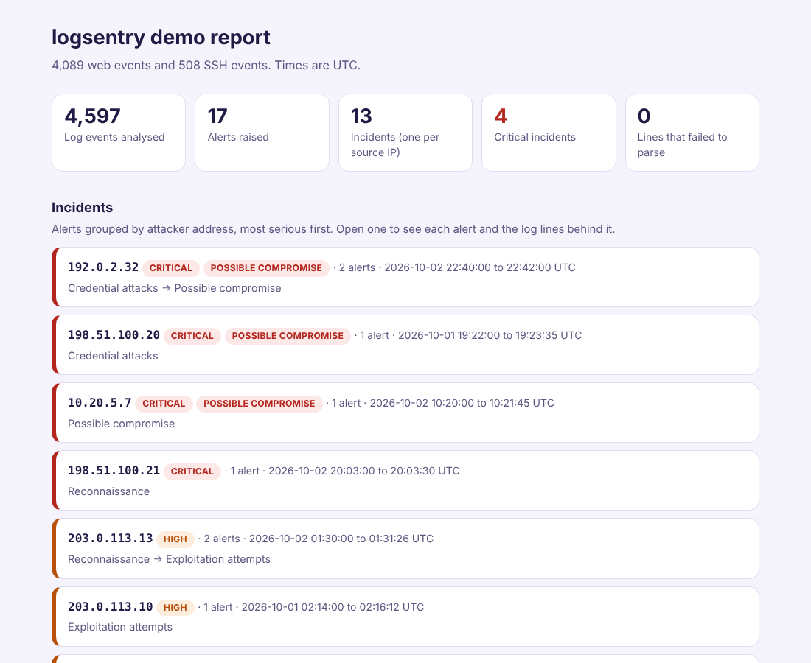
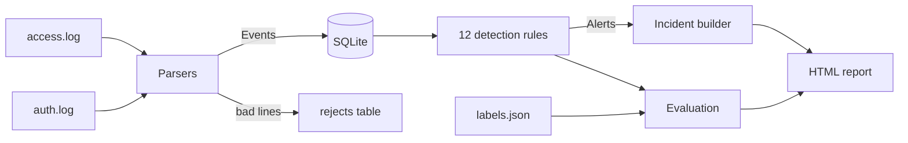

# logsentry


logsentry reads web server access logs and SSH authentication logs, detects attacks in them, groups the alerts into one incident per attacker, and then scores itself against a labelled set of planted attacks so you can see what it catches and what it misses.

Detection tools usually ship with a list of rules and no evidence that the rules work. The part of this project I care most about is the last step: every rule is checked against known attacks and against look-alike harmless traffic (a search crawler hitting dead links, someone searching for the words "select shoes", a person who mistypes a password), and the results, including the failures, are printed in the report.

It has no runtime dependencies beyond the Python standard library and stores everything in SQLite.



## Quick start

Requires Python 3.9 or newer.

```
python3 -m venv .venv
source .venv/bin/activate
python -m pip install --upgrade pip
pip install -e ".[dev]"
pytest
logsentry demo
open demo_output/report.html      # on Linux use xdg-open
```

`logsentry demo` generates a few thousand log lines (ordinary traffic plus 13 labelled attack campaigns), parses them, runs the 12 detection rules, prints the accuracy table, and writes an HTML report. The sample data is fully synthetic, and every attacker address comes from the reserved documentation ranges, so nothing in it points at a real machine.

## Running it on your own logs

```
logsentry ingest --db my.db --web /var/log/nginx/access.log --auth /var/log/auth.log --year 2026
logsentry detect --db my.db
logsentry alerts --db my.db --min-severity high
logsentry report --db my.db --out report.html
```

Web logs must be in the nginx or Apache "combined" format. SSH lines come from OpenSSH in the usual syslog layout. Syslog timestamps carry no year or time zone, so `--year` supplies the year and times are read as UTC. Lines that do not parse are not silently dropped: they are stored in a `rejects` table with the reason, and the report shows the count, because a blind spot in your parser is a blind spot in your monitoring.

Thresholds can be changed with a JSON file (`logsentry detect --config my.json`). Every key is validated, so a typo is an error and not a silently ignored setting.

## How it works



Web and SSH lines are turned into the same `Event` shape, so the rules and the database do not care where a record came from. Ingest is idempotent, because each event is keyed on its file and line number, so running it twice does not double count.

There are two kinds of rule. **Signature rules** look inside a single request for an attack pattern. Before matching, the request is URL-decoded up to three times, which stops `%252e%252e%252f` from hiding a path traversal. **Behaviour rules** count what one source address does inside a time window, using a sliding window that merges overlapping hits so one attack produces one alert and not a hundred.

### Detections

| Rule | Detects | OWASP Top 10 (2021) | ATT&CK | Default trigger |
| --- | --- | --- | --- | --- |
| WEB-001 | SQL injection attempt | A03 Injection | T1190 | Signature in request |
| WEB-002 | Path traversal or file inclusion | A01 Broken Access Control | T1190 | Signature in request |
| WEB-003 | Cross-site scripting probe | A03 Injection | T1190 | Signature in request |
| WEB-004 | Known attack tool user agent | none | T1595.002 | sqlmap, nikto, gobuster and similar |
| WEB-005 | Forced browsing | A01 Broken Access Control | T1595.003 | 15 distinct 404 paths in 60 s |
| WEB-006 | Web login brute force | A07 Authentication Failures | T1110 | 10 failed POSTs to a login URL in 60 s |
| WEB-007 | Secret file or admin panel probing | A05 Security Misconfiguration | T1595.003 | Signature in path, critical if served |
| WEB-008 | Log4Shell JNDI lookup | A06 Vulnerable Components | T1190 | `${jndi:` in path or user agent |
| AUTH-001 | SSH brute force | A07 Authentication Failures | T1110.001 | 8 failures from one IP in 120 s |
| AUTH-002 | SSH password spraying | A07 Authentication Failures | T1110.003 | 5 distinct usernames in 600 s |
| AUTH-003 | SSH success after repeated failures | A07 Authentication Failures | T1078 | 5 failures in the 10 minutes before a login |
| AUTH-004 | Slow SSH brute force | A07 Authentication Failures | T1110.001 | 30 failures in 24 h, unless AUTH-001 already fired |

The category mappings are my own judgement and are meant as a starting point for an analyst to review. Severity can escalate: a login brute force that is followed by a successful login becomes critical, and a request for `/.env` becomes critical if the server answered 200.

### Incidents

An analyst wants one story per attacker, not twenty alerts. Alerts are grouped by source address and labelled with the stages they cover (reconnaissance, exploitation attempts, credential attacks, possible compromise). An attacker who reaches three stages, or who logs in after guessing passwords, is escalated to critical.

## How well does it work

This is the real output of `logsentry demo` (seed 7), scored against the planted attacks. A rule counts as correct for an address when it fires on an attack the labels say it should catch.

| Rule | Caught | Missed | False alarms | Precision | Recall |
| --- | --- | --- | --- | --- | --- |
| WEB-001 | 2 | 0 | 0 | 1.00 | 1.00 |
| WEB-002 | 1 | 0 | 0 | 1.00 | 1.00 |
| WEB-003 | 1 | 0 | 0 | 1.00 | 1.00 |
| WEB-004 | 2 | 0 | 0 | 1.00 | 1.00 |
| WEB-005 | 1 | 0 | 0 | 1.00 | 1.00 |
| WEB-006 | 1 | 0 | 0 | 1.00 | 1.00 |
| WEB-007 | 2 | 0 | 0 | 1.00 | 1.00 |
| WEB-008 | 1 | 0 | 0 | 1.00 | 1.00 |
| AUTH-001 | 2 | 0 | 0 | 1.00 | 1.00 |
| AUTH-002 | 1 | 0 | 0 | 1.00 | 1.00 |
| AUTH-003 | 1 | 0 | 1 | 0.50 | 1.00 |
| AUTH-004 | 1 | 0 | 0 | 1.00 | 1.00 |

Overall precision is 94% and recall is 100%, and 12 of the 13 attack campaigns were noticed. Two results are worth reading closely.

**One planted false positive.** An engineer who forgets a password, fails six times in 90 seconds and then gets in looks exactly like AUTH-003, and the rule fires. That is the rule doing what it was written to do, and it is a good reminder that "success after failures" needs a human to look at it. The fix is to trust internal address space, which is one setting:

```
logsentry demo --config examples/trusted_internal.json
```

With the internal network trusted, precision rises to 100% and recall stays at 100%. The trade-off is that a compromised internal machine now goes unnoticed, so this is a decision for the site and not a free improvement.

**One known gap.** Campaign C12 is 40 different addresses each making two guesses at the same account. Every rule counts per source address, so no single address looks suspicious and nothing fires. The right answer is a rule that counts failures per target account, which is listed under next steps.

The numbers above come with an honest caveat. I wrote both the generator and the rules, so a 100% recall figure shows that the pipeline works end to end and that the thresholds sit sensibly around the planted behaviour, but it does not predict accuracy against real traffic. The harder test is to point the tool at your own logs and read the alerts. I also planted look-alike harmless traffic on purpose, such as nine failed logins in 45 seconds against a threshold of ten, so that the thresholds are tested from both sides, and a test confirms that lowering them produces false positives.

## Design decisions

- **Standard library only.** Parsing, rules, SQLite, evaluation and the report all use the standard library. There is nothing to install and nothing to go stale.
- **Alerts are derived data.** Every detection run replaces the alerts table, so changing a threshold and re-running always gives a consistent result.
- **Evidence travels with the alert.** Each alert keeps up to five of the raw log lines behind it, and alerts that end in a successful login always include that line.
- **The report treats logs as hostile.** Attackers choose what appears in a log, and these logs contain real XSS payloads. Every value is HTML-escaped, the page loads no scripts, fonts or styles from anywhere else, and tests check both. I also opened the report in a browser and confirmed the payloads render as inert text.
- **sshd logs one attempt twice.** For an unknown user it writes both an "Invalid user" line and a "Failed password" line. Only the second is counted, so a single attempt is not counted twice.
- **Quotes in requests.** nginx writes a double quote inside a request as `\x22`. The sample data does the same, and a line with a raw quote is rejected and counted.

## Limitations and next steps

- Signature rules can be evaded by an attacker who knows them, with unusual encodings, comments inside keywords, or case tricks. They find unsophisticated and automated attacks well, which is most of what hits a public site.
- Detection is per source IP. Attackers behind a shared address (a university, an office) can trigger false alarms, and attackers spread across many addresses are the known gap above.
- A per-target-account rule, geolocation or reputation data for addresses, and a baseline of normal behaviour per user would be the next detections to add.
- Events are loaded into memory for detection, which is fine for hundreds of thousands of lines and not for gigabytes. A streaming version or SQL window queries would be the next step.
- Thresholds are defaults that need tuning for each site's normal traffic.
- Logs are read after the fact. This is an analysis tool and not a live monitor.

## Tests

```
pytest
```

The suite has 111 tests. Each detection rule is tested three ways: it fires on the attack (including encoded and double-encoded variants), it stays quiet on harmless look-alikes, and it behaves correctly exactly at its threshold. Other tests cover the parsers (malformed lines, time zones, a leap-year boundary, IPv6), idempotent ingest, database constraints, incident escalation, report escaping, deterministic generation, the scoring maths, and the command line including error exit codes.

To check that the tests can fail, I broke the code in nine deliberate ways (an off-by-one at the window edge, removing a SQL injection pattern, turning off HTML escaping, decoding URLs once instead of repeatedly, flipping the time-zone sign, and so on) and confirmed each one made a test fail. CI runs everything on Python 3.9 and 3.12.

## License

MIT
